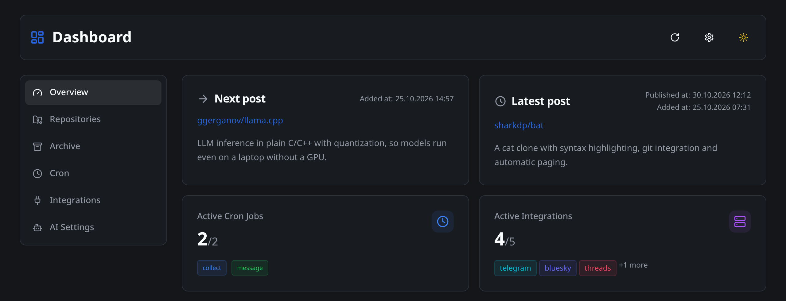
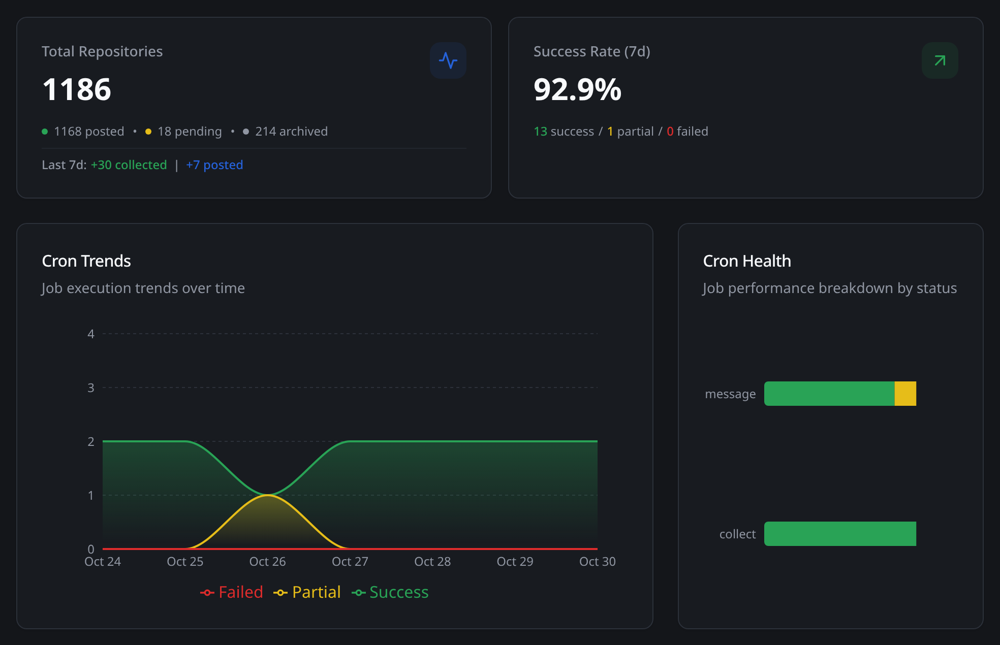
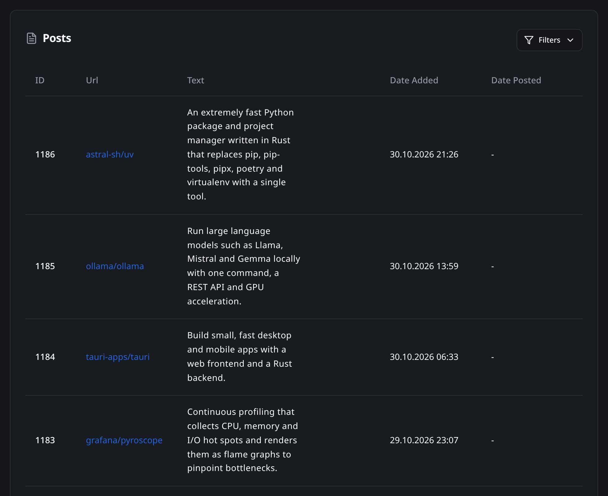
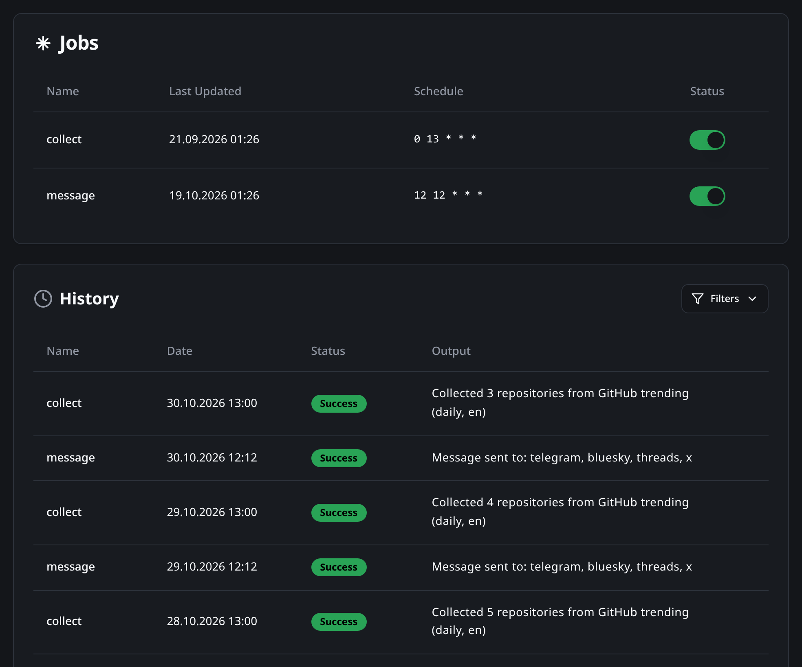
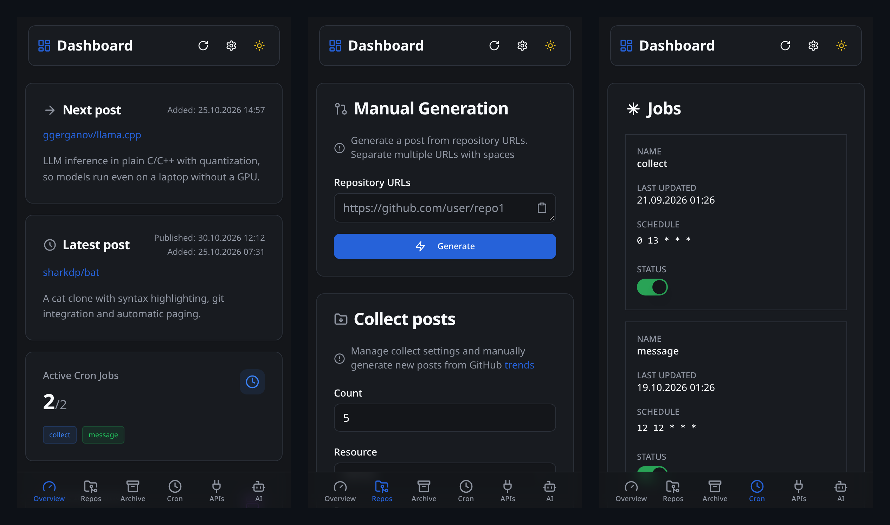

<h1 align="center">Content Sentinel</h1>

<div align="center">


[](https://reactjs.org/)
[](https://vitejs.dev/)
[](https://github.com/think-root/content-sentinel/releases)
[](https://github.com/think-root/content-sentinel/blob/main/CHANGELOG.md)


</div>

## Description

A dashboard to monitor and manage the [content-alchemist](https://github.com/think-root/content-alchemist) repository database and the [content-maestro](https://github.com/think-root/content-maestro) cron jobs and integrations through their APIs. Both services have to be running for the dashboard to work.

## Features

- **Overview**: the next and the latest post, active cron jobs and integrations, repository totals, cron success rate and trends, and the technologies trending among collected repositories
- **Repositories**: generate posts from repository URLs or collect them from GitHub trending; search, filter and sort posts; edit a post's text, publish it next or right away, archive or delete it
- **Archive**: browse archived posts with filters, and archive published posts older than a given number of days, with a preview first
- **Cron**: change job schedules, enable or disable jobs, browse the run history and re-send a publication to the integrations it missed
- **Integrations**: add, edit and remove the social networks posts are published to
- **AI Settings**: LLM provider (OpenAI, Mistral API, OpenRouter), model, temperature, output languages and the prompt used to write posts
- Light and dark theme, and a mobile layout with bottom navigation

## Technology Stack

- **Frontend**: React 18 with TypeScript
- **Styling**: Tailwind CSS and Radix UI
- **Charts**: Recharts
- **Build Tool**: Vite
- **Tests**: Vitest

## Screenshots

<details>
  <summary>Show me what's hidden</summary>

  

  

  

  

  

</details>

## Getting Started

### Prerequisites

- Node.js 20 or newer
- npm

### Installation

1. Clone the repository

   ```bash
   git clone https://github.com/think-root/content-sentinel.git
   cd content-sentinel
   ```

2. Install dependencies

   ```bash
   npm ci
   ```

3. Create an environment file

   ```bash
   cp .env.example .env
   ```

4. Update the `.env` file with your data

   ```bash
   PORT=3000
   ALCHEMIST_URL=https://alchemist.example.com
   ALCHEMIST_TOKEN=your-alchemist-token
   MAESTRO_URL=https://maestro.example.com
   MAESTRO_TOKEN=your-maestro-token
   ```

   The browser never sees the URLs and tokens: it calls the dashboard's own `/proxy/` path, and the server adds them (see [How the API is reached](#how-the-api-is-reached)).

   Anyone who can open the dashboard can use the backend through it, so `npm start` and Docker only proxy when the dashboard is protected. Pick one:

   - [Cloudflare Access](#cloudflare-pages): set `ACCESS_TEAM_DOMAIN` and `ACCESS_AUD`.
   - A password: set `BASIC_AUTH_USER` and `BASIC_AUTH_PASSWORD`, and the browser asks for them before showing the dashboard. Use a long random password, and HTTPS if the server is reachable from the internet, since Basic Auth sends the password with every request.
   - Nothing, on a machine or network nobody else can reach: set `ALLOW_UNAUTHENTICATED_PROXY=true`.

   `npm run dev` and `npm run preview` listen on localhost and need none of them.

5. Build the project

   ```bash
   npm run build
   ```

6. Start the production server at http://localhost:3000/

   ```bash
   npm start
   ```

   Or preview the build with Vite at http://localhost:4173/

   ```bash
   npm run preview
   ```

### Docker

```bash
cp .env.example .env
docker compose up -d --build
```

The dashboard is served on the `PORT` from `.env` (3000 by default).

### Cloudflare Pages

Build command `npm run build`, output directory `dist`. The `functions/` directory deploys the proxy as a Pages Function.

1. Put the dashboard behind [Cloudflare Access](https://developers.cloudflare.com/cloudflare-one/applications/configure-apps/self-hosted-public-app/): a self-hosted application for `<project>.pages.dev` and `*.<project>.pages.dev`, so preview deployments are covered too.
2. Add these variables to the Pages project, for production and preview; make the tokens secrets:

   | Variable                                     | Value                                                         |
   | -------------------------------------------- | ------------------------------------------------------------- |
   | `ALCHEMIST_URL`, `ALCHEMIST_TOKEN`           | Content Alchemist URL and bearer token                        |
   | `MAESTRO_URL`, `MAESTRO_TOKEN`               | Content Maestro URL and bearer token                          |
   | `ACCESS_TEAM_DOMAIN`                         | Your team domain, e.g. `your-team.cloudflareaccess.com`       |
   | `ACCESS_AUD`                                 | Application Audience (AUD) tag of the Access application      |

The proxy checks the Access token of every request and refuses to work on Pages without `ACCESS_TEAM_DOMAIN` and `ACCESS_AUD`, since a `pages.dev` site is public.

### How the API is reached

The dashboard calls `/proxy/alchemist/api/...` and `/proxy/maestro/api/...` on its own origin. The proxy ([`api-proxy.js`](api-proxy.js)) forwards the request to the service with its bearer token, so the tokens stay on the server. It runs as the Pages Function on Cloudflare, inside `server.js` for `npm start` and Docker, and inside Vite for `npm run dev` and `npm run preview`. All of them read the variables above. Only `/proxy/<service>/api/...` is forwarded, and only requests that carry the dashboard's own `X-Content-Sentinel` header, which another site can't make the browser send.

### Development

```bash
npm run dev        # dev server with hot reload
npm run typecheck  # TypeScript
npm run lint       # ESLint
npm test           # unit tests
```

### Configuration Settings

Display settings are in the site header on the right, the "Settings" button. The backend services are configured on the server, see [Installation](#installation).

| Tab         | Setting                   | Description                                                                                                                                                        |
| ----------- | ------------------------- | ------------------------------------------------------------------------------------------------------------------------------------------------------------------ |
| **General** | Date Format               | Pick a format from the list, e.g. `DD.MM.YYYY HH:mm`, `MM/DD/YYYY hh:mm A` or `YYYY-MM-DD HH:mm`; formats with time can also show seconds. **Default:** `DD.MM.YYYY HH:mm` |
|             | Timezone                  | IANA timezone the dates are shown in (**default:** `Europe/Kyiv`)                                                                                                    |
|             | Language Code             | [ISO 639-1](https://en.wikipedia.org/wiki/ISO_639-1) code of the post texts to display (**default:** `uk`)                                                         |
| **Cache**   | Clear API Cache           | Drops cached API responses and reloads the data                                                                                                                    |

These settings are saved in your browser's local storage.

## License

This project is licensed under the terms found in the [LICENSE](LICENSE) file in the repository root.
